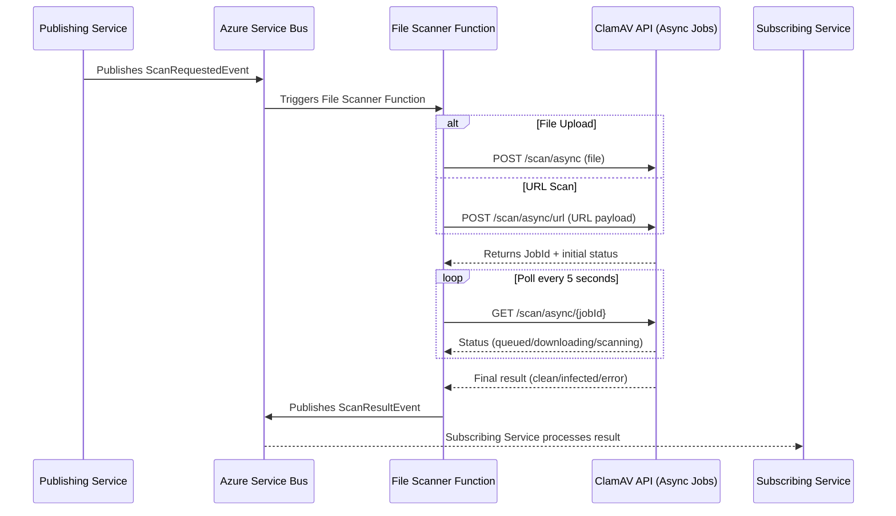

# ☁️ GovUK DfE File Scanner Function

The **File Scanner Function** is an event-driven Azure Function designed to scan files for viruses using the [ClamAV API](https://github.com/DFE-Digital/rsd-clamav-api).  

It listens for **file scan requests** on an Azure Service Bus topic, submits asynchronous jobs to the ClamAV API, **polls for job completion every 5 seconds**, and finally publishes scan results to a results topic for consumption by other services.

This service is part of the **DfE CoreLibs Virus Scanning Framework**, but can be used independently by any application that needs automated, event-driven virus scanning.

---

## 🚀 Features

- 📨 Event-driven architecture using Azure Service Bus  
- 🔒 ClamAV integration with async job-based scanning  
- 🔁 Automatic 5-second polling of ClamAV job status  
- 💾 Supports Azure File Share and local file access  
- ⚡ Redis caching — prevents duplicate scans for identical files  
- 🧠 Automatic dead-lettering of invalid or incomplete messages  
- 🔄 Publishes results to a Service Bus topic  
- 🧩 Framework-agnostic — can be used by any service needing virus scanning  

---

## 🧩 Architecture Overview

This function works alongside the ClamAV API to form a simple, event-driven virus scanning pipeline.

| Component | Role |
|-----------|------|
| **File Scanner Function** | Receives scan requests, submits async scan jobs, polls until complete, publishes results |
| **ClamAV API** | Performs scanning, manages download + scan workflow via async jobs |

---

## 🧭 Process Flow

1. A service publishes a **`ScanRequestedEvent`** to the `file-scanner-requests` topic.  
2. The File Scanner Function receives the message.  
3. The function sends the file or URL to the ClamAV API’s **async scan endpoint**.  
   - `/scan/async` for file uploads  
   - `/scan/async/url` for URL downloads  
4. ClamAV immediately returns:
   - a **Job ID**
   - an initial status (`queued`, `downloading`, etc.)  
5. The Function begins a **polling loop every 5 seconds**:
   - GET `/scan/async/{jobId}`  
   - Continues until job status is:  
     - `clean`  
     - `infected`  
     - `error`  
6. Once the job completes, the Function publishes a **`ScanResultEvent`** to the `file-scanner-results` topic.  
7. Subscribing services process the result accordingly (delete or quarantine infected files, notify users, etc.).

---

## 🧩 System Flow Diagram



---

## 📬 Message Contracts

### 📨 `ScanRequestedEvent`

Published by any service requesting a file scan.

```csharp
public record ScanRequestedEvent(
    string? FileId,
    string FileName,
    string? FileHash,
    string? Reference,
    string? Path,
    bool? IsAzureFileShare,
    string FileUri,
    string ServiceName,
    Dictionary<string, object>? Metadata);
```

---

### 🧾 `ScanResultEvent`

Published by the File Scanner Function once the job completes.

```csharp
public record ScanResultEvent(
    string ServiceName,
    string FileUri,
    string FileName,
    string? FileId = null,
    string? Reference = null,
    string? Path = null,
    bool? IsAzureFileShare = null,
    string? CorrelationId = null,
    ScanStatus Status = ScanStatus.Completed,
    VirusScanOutcome? Outcome = null,    
    string? MalwareName = null,
    DateTimeOffset? ScannedAt = null,
    string? ScannerVersion = null,
    string? Message = null,
    int? TimeoutSeconds = null,
    string? VendorJobId = null,
    Dictionary<string, object>? Metadata = null);
```

---

## ⚙️ Configuration

### Environment Variables

| Key | Description | Example |
|-----|-------------|---------|
| `TOPIC_NAME` | Topic to listen for requests | `file-scanner-requests` |
| `SUBSCRIPTION_NAME` | Subscription name | `file-scanner-function` |
| `VirusScannerApi:BaseUrl` | ClamAV API base URL | `http://clamav-api:8080` |
| `VirusScannerApi:ScanEndpoint` | Async file scan endpoint | `/scan/async` |
| `VirusScannerApi:UrlScanEndpoint` | Async URL scan endpoint | `/scan/async/url` |
| `VirusScannerApi:StatusEndpoint` | Job status endpoint | `/scan/async/{jobId}` |
| `VirusScannerApi:PollingIntervalSeconds` | Poll interval | `5` |
| `VirusScannerApi:PollingTimeoutSeconds` | Maximum wait time | `300` |
| `ServiceBus` | Azure Service Bus connection string | *(secure)* |
| `Redis` | Redis connection string | `localhost:6379,abortConnect=false` |

---

## 🧱 Local Development

You can run the Function locally using **Azure Functions Core Tools**.

### Prerequisites

- .NET 8 SDK  
- Azure Functions Core Tools  
- Docker (for ClamAV API)  
- Running instance of the ClamAV API container  

### Running Locally

```bash
func start
```

Make sure `local.settings.json` contains:

- ClamAV API URL  
- Service Bus connection  
- Redis connection  
- Polling values  

---

## 🔍 Example Workflow

### 1. A publishing service sends this:

```json
{
  "fileName": "upload.pdf",
  "fileHash": "abc123",
  "fileUri": "https://example.file.core.windows.net/share/path/upload.pdf?sv=...",
  "serviceName": "ExampleApp"
}
```

---

### 2. The Function sends an async scan request:

Response from ClamAV:

```json
{
  "jobId": "job-789",
  "status": "downloading"
}
```

---

### 3. The Function polls every 5 seconds

```
{ "status": "downloading" }
{ "status": "scanning" }
{ "status": "clean" }
```

---

### 4. The Function publishes:

```json
{
  "serviceName": "ExampleApp",
  "fileUri": "https://example.file.core.windows.net/share/path/upload.pdf",
  "fileName": "upload.pdf",
  "outcome": "Clean",
  "scannerVersion": "0.103.10",
  "message": "File is clean"
}
```

---

## 🧠 Notes

- URL downloads happen **within the ClamAV API**, not inside this Function.  
- Polling continues until job completion or timeout.  
- Redis caching allows previously scanned files (same hash) to be skipped.  
- Invalid messages are automatically moved to the dead-letter queue.  
- The ClamAV API updates its virus definitions automatically on container start.  

---
